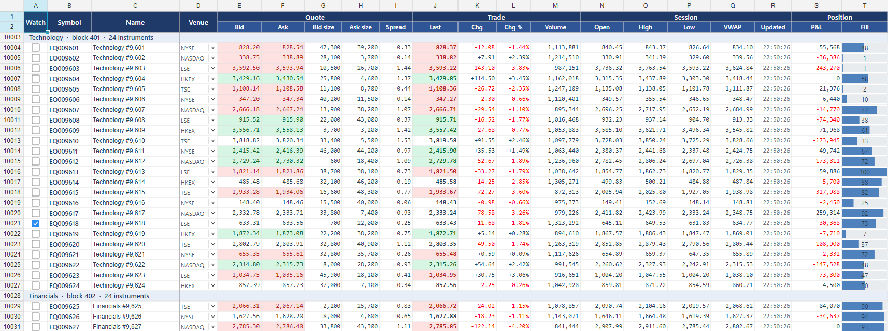

# LiveMarketGrid (Avalonia) — a ticking market-data grid

The Avalonia version of [WinForms/LiveMarketGrid](../../WinForms/LiveMarketGrid): a market-data monitor
built on **ReoGrid One** (V5) with three sheets (Equities / FX / Futures) of **100,000 instruments × 20
fields** each. It runs on Windows, macOS and Linux.

The toolbar lets you change how the feed drives the grid, and the status bar shows what that costs:

- how often it ticks, up to every frame the display shows;
- which cells a tick changes;
- which call asks for the repaint.



The sheet layout is the same as the WinForms sample: two-row grouped header, merged group rows,
fonts per column, checkbox / dropdown / progress-bar cell types, number formats and frozen panes.

## Requirements

- **.NET 10 SDK** (10.0.301 or later), on Windows, macOS or Linux
- The **UNVELL package feed** registered once — see the [repository README](../../README.md#getting-started--はじめに)
- **ReoGrid One 5.2.0 or later** (`unvell.ReoGrid.One.Avalonia`) for the numbers below. The sample builds
  against 5.1.0. It does not build against 5.0.0, which has no `Worksheet.View`.
- A license key is optional. Without one the grid runs read-only with an evaluation watermark.

## Run

```bash
dotnet run -c Release --project Avalonia/LiveMarketGrid
```

| Toolbar | Choices |
|---|---|
| **Tick** | every frame (as fast as the display refreshes), 50 ms, 100 ms, **250 ms**, 1 s |
| **Update** | **Market feed**: about 85% of the visible instruments move, 15 fields each, plus 5,000 random instruments on every sheet<br>**Clock column + 8 prices**: the *Updated* column of every visible row gets the time as text (`HH:mm:ss.fff`), and 8 last prices move. That is about 108 cells on a 100-row window.<br>**Every visible instrument**: all 15 fields of every visible instrument<br>**Nothing**: repaint only |
| **Repaint with** | `InvalidateVisual()` or `RefreshExternal()` |
| **Off-screen updates / sheet** | instruments moved per sheet per tick in the market feed |

The status bar shows three figures:

- **Render**: the grid's `Render` on the UI thread.
- **frames/s**: how many repaints reached the screen in the last second.
- **Update**: what writing the tick into the model cost.

Measure a **Release** build without the debugger attached.

## Measure

```bash
dotnet run -c Release --project Avalonia/LiveMarketGrid -- --bench
```

The benchmark maximizes the window and warms up. It then runs each update pattern for 300 frames,
**ticking on every frame** — the fastest an application can update. For each pattern it records:

- the model update;
- the grid's `Render` on the UI thread;
- the interval between frames.

Next it paints **exactly 100 rows × 20 columns** off screen, with layout and Skia rasterization on
one thread, so the result does not depend on the monitor. It writes `bench-results.md` next to the
executable.

Options: `--rows 100000`, `--frames 300`, `--background 5000`, `--out file.md`.

### Results

Measured on an AMD Ryzen 9 9900X with Windows 11, .NET 10.0.13 and Avalonia 11.3.17. The display is
3840×2160 at 150% and refreshes at 120 Hz. Maximized, the grid shows 63 rows × 20 columns. Medians.

**On screen, one tick per frame.** *Render* is the UI-thread time per repaint; *frames/s* includes
everything, and 120 is the display's limit.

| Update pattern | 5.1.0 Render | 5.1.0 frames/s | 5.2.0 Render | 5.2.0 frames/s |
|---|---:|---:|---:|---:|
| Clock column + 8 prices, `InvalidateVisual()` | 34.8 ms | 26 | **1.4 ms** | **119** |
| Clock column + 8 prices, `RefreshExternal()` | 34.6 ms | 27 | **1.4 ms** | **120** |
| Every visible instrument (15 fields × 63 rows) | 33.6 ms | 27 | **2.6 ms** | **119** |
| Market feed, incl. 3 × 5,000 off-screen instruments | 28.4 ms | 21 | **2.9 ms** | **102** ¹ |
| Nothing changes, repaint only | 34.1 ms | 27 | **0.8 ms** | **121** |

¹ The market feed also writes 15,000 off-screen instruments each tick. That update takes 19.2 ms on
5.1.0 and 6.6 ms on 5.2.0, on the same UI thread. At a 250 ms tick, the whole tick uses about 4% of
the UI thread.

**Off screen, exactly 100 rows × 20 columns:** layout plus rasterization of one repaint.

| Update pattern | 5.1.0 | 5.2.0 |
|---|---:|---:|
| Clock column + 8 prices, 100% | 55.6 ms | **4.4 ms** |
| Every visible instrument, 100% | 53.7 ms | **7.9 ms** |
| Market feed, 100% | 51.3 ms | **8.8 ms** |
| Market feed, 150% | 53.0 ms | **10.4 ms** |

## How the grid repaints, and what that means for a live feed

**The grid always repaints its whole visible window.** There is no call to repaint a few cells:
Avalonia renders a control as a whole. On 5.1.0, this is why changing 108 cells cost the same as
changing all of them: every visible cell was laid out again on every frame.

From 5.2.0 the laid-out text of each cell is kept between frames. A repaint now costs about 0.8 ms
for the window, plus the cells whose text changed. On the 63 × 20 window above, that is 1.4 ms for
the clock column plus 8 prices, and 2.6 ms for every field of every row.

**Use `InvalidateVisual()` after writing values.**

```csharp
foreach (var q in quotes) sheet.SetNumber(q.Row, q.Col, q.Value);   // any number of cells
grid.InvalidateVisual();                                             // once per batch
```

The model raises no change events and the control does not watch it, so ask for the repaint
yourself, **once per batch**. Avalonia folds any number of `InvalidateVisual()` calls into one
render on the next frame.

`RefreshExternal()` is meant for changes to the sheet's *structure* made outside the control, such as
rows, columns or sizes. It also re-measures the scrollbars and raises `SelectionChanged`. It costs the
same as `InvalidateVisual()` (see the table), but it says more than "values changed".

**Write values one cell at a time; that is the bulk API.** `SetNumber`, `SetText` and `SetValue`
write straight into the columnar store, with no events and no repaint:

- 2,000,000 `SetNumber` calls take about 20 ms;
- this sample's whole market tick (about 15,000 instruments × 15 fields) takes 7 ms.

V5 has no `SetRangeData`; that name belongs to V4.

**Keep live values in the sheet.** An `IRowDataSource` fills rows the first time they come into view
and is meant for loading very large data sets lazily. It works with a live feed, but writing the new
values directly is simpler and just as fast.

**Give numeric columns a number format.** A value such as `NextDouble() * 100` shown in *General* has
15 significant digits (`28.099051969172`). It is wider than a default column, so it has to be rounded
to fit on every repaint (5.2.0, as in Excel). Formatted values skip that step.

**Measure inside `Render`, and watch the frame rate.** See `TimedReoGridControl`. On Avalonia,
`Render` lays out and records the drawing on the UI thread, and Avalonia rasterizes it on its render
thread. Frames per second covers both.

## Files

| File | |
|---|---|
| `MarketSheet.cs` | sheet layout — header, groups, styles, number formats, cell types — and the per-instrument state (shared with the WinForms sample) |
| `MarketFeed.cs` | the simulated feed and its update patterns |
| `TimedReoGridControl.cs` | `ReoGridControl` with render timing and a frame counter |
| `MainWindow.cs` | the window, toolbar, sheet tabs and status bar |
| `Benchmark.cs` | the `--bench` measurement and report |
| `LicenseLoader.cs` | applies a license key from the environment or the license file, if present |
