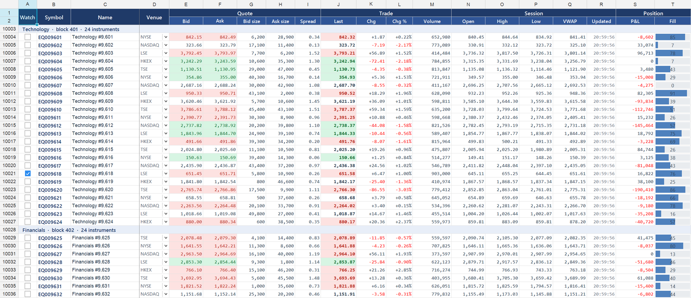

# LiveMarketGrid — a ticking market-data grid, on Direct2D or GDI+

A WinForms market-data monitor built on **ReoGrid One** (V5): three sheets (Equities / FX / Futures)
of **100,000 instruments × 20 fields** each. It draws with **Direct2D** (ReoGrid One 5.2.0 and later),
and the toolbar switches to GDI+ so you can compare the two on your own machine.

The toolbar also sets how the feed drives the grid, up to a tick on every frame the display shows,
and which cells a tick changes. The status bar shows what every repaint costs, measured inside
`OnPaint`.



What is on screen is what a trading or monitoring desk typically needs:

| Feature | How the sample does it |
|---|---|
| Two-row grouped header | header cells merged across columns (*Quote*, *Trade*, …) and rows (*Symbol*, *Name*, …) |
| Group rows | one merged row per block of 24 instruments, styled on the row |
| Fonts per column | `SetColumnStyle` — Consolas for numbers, Segoe UI Semibold for symbols, Arial for names |
| Cell types | checkbox (*Watch*), dropdown (*Venue*), progress bar (*Fill*), assigned per block as ranges |
| Number formats | prices, sizes, signed change / change % with red negatives, time of the last update |
| Frozen panes | the two header rows and the *Watch / Symbol / Name* columns |
| Live updates | four update patterns (below); moved bid / ask / last cells flash green or red |
| Selection | select rows and columns as usual; ticking continues underneath |

## Requirements

- Windows, **.NET 10 SDK** (10.0.301 or later)
- The **UNVELL package feed** registered once — ReoGrid One is not on nuget.org. See
  [Installation](https://reogrid.net/docs/v5/getting-started/installation) (create an access token in the
  [portal](https://portal.unvell.com/access-tokens), then `dotnet nuget add source …`).
- **ReoGrid One 5.2.0 or later** (`unvell.ReoGrid.One`), which has the Direct2D renderer.
- Direct2D runs in an x64 or x86 process. An ARM64 process, or a machine where Direct2D cannot
  start, stays on GDI+, and the status bar says so.
- A license key is optional. Without one the grid runs read-only with an evaluation watermark,
  which is all this display needs. With one, set the `REOGRID_LICENSE` environment variable or
  put the key in `%LOCALAPPDATA%\unvell\reogrid\license.txt`.

## Run

```bash
dotnet run -c Release --project WinForms/LiveMarketGrid
dotnet run -c Release --project WinForms/LiveMarketGrid -- --renderer gdi    # start on GDI+
```

| Toolbar | Choices |
|---|---|
| **Renderer** | **Direct2D**, GDI+ — switchable while the feed runs |
| **Tick** | every frame (once per frame the display shows), 50 ms, 100 ms, **250 ms**, 1 s |
| **Update** | **Market feed**: about 85% of the visible instruments move, 15 fields each, plus 5,000 random instruments on every sheet<br>**Clock column + 8 prices**: the *Updated* column of every visible row gets the time as text (`HH:mm:ss.fff`), and 8 last prices move<br>**Every visible instrument**: all 15 fields of every visible instrument<br>**Nothing**: repaint only |
| **Off-screen updates / sheet** | instruments moved per sheet per tick in the market feed |
| **Flash changes** | moved prices flash until the next tick |

The status bar shows:

- the renderer that is drawing;
- **Paint**: one repaint, timed inside `OnPaint`;
- **frames/s**: repaints in the last second;
- **Update**: what writing the tick into the model cost.

Always measure a **Release** build without the debugger attached — a Debug build is several times
slower and says nothing about production.

## Measure

```bash
dotnet run -c Release --project WinForms/LiveMarketGrid -- --bench
```

The benchmark opens the window maximized and runs every update pattern on GDI+, then on Direct2D:

- **back to back**: tick, repaint, next tick, recording the update, the paint and the whole tick;
- **one tick per display frame** for 3 seconds, counting the repaints that reach the window.

It writes `bench-results.md` next to the executable. Options: `--rows 100000`, `--ticks 200`,
`--background 5000` (off-screen instruments per sheet per tick), `--out file.md`.

### Results

AMD Ryzen 9 9900X, NVIDIA GeForce RTX 3080 Ti, Windows 11, .NET 10.0.13, ReoGrid One 5.2.0. The
display is 3840×2160 at 150% and refreshes at 120 Hz; maximized, the grid shows 63 rows × 20
columns. Ticking once per display frame, medians:

| Update pattern | GDI+ paint | GDI+ frames/s | Direct2D paint | Direct2D frames/s |
|---|---:|---:|---:|---:|
| Clock column + 8 prices | 17.6 ms | 41 | **2.7 ms** | **120** |
| Every visible instrument (15 fields × 63 rows) | 17.5 ms | 41 | **4.4 ms** | **120** |
| Market feed, incl. 3 × 5,000 off-screen instruments | 17.6 ms | 33 | **5.2 ms** | **59** ¹ |
| Nothing changes, repaint only | 17.0 ms | 42 | **2.5 ms** | **120** |

¹ The market feed also writes 15,000 off-screen instruments on every tick, about 7 ms on the same
UI thread. With the repaint that is more than one 120 Hz frame, so every other frame carries a tick.
At a 250 ms tick, the whole tick uses about 5% of the UI thread.

With Direct2D, *Paint* includes presenting the frame to the window. With GDI+ it does not include
copying the back buffer to the window, about 3.5 ms more at this size (the report's *Tick* column
includes it).

## Demo

```bash
dotnet run -c Release --project WinForms/LiveMarketGrid -- --demo
```

A scripted, full-screen run of about 80 seconds, made to be recorded as a video. It plays three
rounds, each first on GDI+ and then on Direct2D, ticking once for every frame the display shows:

| Round | What changes on every frame |
|---|---|
| Every visible cell, every frame | all 15 fields of every visible instrument |
| Scrolling while it updates | the same, while the grid scrolls 30 rows a second |
| A clock column and 8 prices | the *Updated* column of every visible row, and 8 last prices |

A band above the grid shows the renderer that is drawing, the paint time, the frames per second
and a graph of the paint time over the last 30 seconds. The first repaint after a switch sets the
new renderer up; it is left out of the band. The grid is zoomed so that its 20 columns fill the
screen, and moved prices do not flash: a flash on every frame would strobe. The run ends with the
median paint time and frame rate it measured in each round, and the machine it ran on. Esc ends it
early.

`--sync` is for a recording script: the demo prints `ready` with the title card on screen and
waits for a line on standard input; at the end it prints `done` and waits for another line before
it closes the window.

## Why Direct2D, and how to switch

**GDI+ draws the text of every visible cell on every repaint.** That is why its paint time is the
same whether nothing, a few cells or every cell changed: 17.0–17.6 ms above. It grows with the
number of visible cells and the display scale.

**Direct2D draws on the GPU and keeps the laid-out text of each cell between frames.** A repaint
costs about 2.5 ms for this window, plus the cells whose text changed: 2.7 ms for the clock column
and 8 prices, 4.4 ms for every field of every row.

```csharp
using unvell.ReoGrid.WinForms;

grid.Renderer = GridRenderer.Direct2D;   // the default is GridRenderer.Gdi

// Where Direct2D cannot run (an ARM64 process, no Direct3D device) the control stays on GDI+.
if (grid.ActiveRenderer != GridRenderer.Direct2D)
	Debug.WriteLine("drawing with GDI+");
```

The native DLLs ship in the `unvell.ReoGrid.One` package and are copied to the build output
(`runtimes/win-x64/native/d2dlib64.dll`, `runtimes/win-x86/native/d2dlib32.dll`), so there is
nothing else to install. Printing and `RenderTo(graphics, …)` draw with GDI+ either way. See
[WinForms › Renderer](https://reogrid.net/docs/v5/platform/winforms).

## Patterns that keep a ticking grid fast

**1. Write to the model, then ask for one repaint per tick.**

```csharp
foreach (var q in quotes) sheet.SetNumber(q.Row, q.Col, q.Value);   // any number of cells
grid.Invalidate();                                                   // once
```

The model has no change event and the control does not watch it, so you request the repaint
yourself — **once per batch**. `Invalidate()` only marks the window dirty; Windows folds every
request into one `WM_PAINT`. `Refresh()` or `Update()` after each cell paints the whole window once
per cell instead. Measured on GDI+, 2,000 cells take about **23 seconds** per tick that way, against
**11 ms** with one `Invalidate()`.

There is no call to repaint only some cells: the grid repaints its visible window. On Direct2D,
cells that did not change cost very little.

**2. Tick at most once per displayed frame.** A display shows 60 or 120 frames a second; ticks
beyond that are never seen. `FramePacer` shows one way to tick on every frame in WinForms: a
background thread waits for each desktop composition (`DwmFlush`), and the next tick is posted only
after the previous one has been painted.

**3. Keep all the data in the sheet.** Writing is cheap — 2,000,000 `SetNumber` calls take about
20 ms — and painting reads only the visible window. There is no need for an `IRowDataSource` to
feed live values; that interface is for loading very large data sets lazily.

**4. Give numeric columns a number format.** A value such as `NextDouble() * 100` displayed in
*General* format has 15 significant digits (`28.099051969172`). It is wider than a default column,
so each new value has to be rounded to fit, as in Excel. Formatted values skip that step.

**5. Style columns and rows, not cells.** `SetColumnStyle` / `SetRowStyle` store one entry for the
whole line. Keep per-cell styles for what really is per cell — the flash in this sample.

**6. Assign cell types and merges by range.** One `SetCellType(range, …)` per block, not one call
per cell. Drawing depends only on the merges and cell types in view, however many the sheet has.

**7. Limit visual effects to the visible window.** The flash in `MarketFeed` touches only the cells
on screen and clears them on the next tick, so it costs the same however large the sheet is.

**8. Measure inside `OnPaint`.** See `TimedReoGridControl`: a stopwatch around `base.OnPaint`
separates paint time from everything else on the UI thread.

## Files

| File | |
|---|---|
| `MarketSheet.cs` | sheet layout — header, groups, styles, number formats, cell types — and the per-instrument state |
| `MarketFeed.cs` | the simulated feed and its update patterns: visible window, off-screen updates, flash |
| `TimedReoGridControl.cs` | `ReoGridControl` with paint timing and a frame counter |
| `FramePacer.cs` | ticks once per frame the display shows |
| `MainForm.cs` | the window, toolbar, sheet tabs and status bar |
| `Benchmark.cs` | the `--bench` measurement and report |
| `Demo.cs` | the `--demo` run: rounds, measurement, cards |
| `DemoHud.cs` | the band above the grid in the demo: renderer, paint time, frame rate, graph, caption |
| `DemoCard.cs` | the demo's full-window title, code and results cards |
| `SystemInfo.cs` | CPU, GPU, display and versions for the report and the results card |
| `LicenseLoader.cs` | applies a license key from the environment or the license file, if present |
